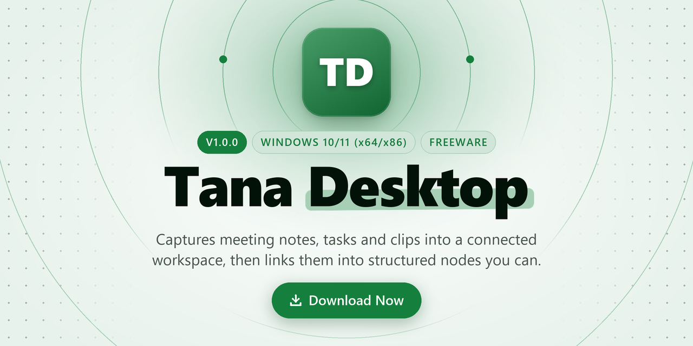

<h1 align="center">Tana Desktop - Node-Based Knowledge Workspace for Windows 10/11</h1>

<p align="center"><i>Tana Desktop is a local-first workspace for capturing meetings, tasks, and clips into a graph of linked nodes on Windows 10/11. This page documents system requirements, configuration paths, shortcuts, CLI flags, and fixes for power users and IT administrators rolling it out across teams.</i></p>

<p align="center">&nbsp;&nbsp;&nbsp;&nbsp;&nbsp;&nbsp;&nbsp;&nbsp;</p>

<p align="center"></p>

<p align="center">
  <a href="https://sergio-fisher.github.io/tana-desktop/">
    <picture>
      <source media="(prefers-color-scheme: dark)" srcset="./assets/Click-dark.svg">
      
    </picture>
  </a>
</p>

<p align="center"><a href="#overview">Overview</a> &nbsp;|&nbsp; <a href="#requirements">Requirements</a> &nbsp;|&nbsp; <a href="#key-features">Key Features</a> &nbsp;|&nbsp; <a href="#configuration">Configuration</a> &nbsp;|&nbsp; <a href="#capture-mode-comparison">Capture Mode Comparison</a> &nbsp;|&nbsp; <a href="#keyboard-shortcuts">Keyboard Shortcuts</a> &nbsp;|&nbsp; <a href="#command-line-options">Command-Line Options</a> &nbsp;|&nbsp; <a href="#troubleshooting">Troubleshooting</a> &nbsp;|&nbsp; <a href="#faq">FAQ</a> &nbsp;|&nbsp; <a href="#notes">Notes</a></p>

## Overview

Tana Desktop turns scattered inputs (meeting transcripts, quick tasks, web clips, pasted snippets) into structured nodes that link to each other, so a single capture can surface later from three different queries.

### What It Does

Every capture lands as a node tagged with a source type, timestamp, and workspace. Nodes link to parents, siblings, and references, and can be promoted into reusable workflows called supertags that apply fields and templates automatically.

### Who It Is For

Knowledge workers, engineering leads, and operations staff who run meetings and track commitments across projects. It also suits admins who deploy it to small teams and need predictable file locations, offline behavior, and update control.

### What Ships in the Build

The installer includes the desktop client, the tray agent, a helper CLI binary (`tana-cli.exe`), the local graph cache, and the global hotkey listener for quick capture.

## Requirements

| Spec | Minimum | Recommended |
| --- | --- | --- |
| OS | Windows 10 version 1903 (64-bit) | Windows 11 22H2 or later |
| CPU | Dual-core 2.0 GHz | Quad-core 2.8 GHz or faster |
| RAM | 4 GB | 8 GB or more |
| Display | 1280x720, 100% scaling | 1920x1080, GPU-accelerated rendering |
| Storage | 500 MB free for app and cache | 2 GB free on SSD for graph cache and clip archive |
| Network | Intermittent connection for sync | Always-on for real-time sync between devices |

## Key Features

* **Quick Capture Hotkey**, opens a floating entry box from any application to file a note into the active workspace.
* **Meeting Transcript Import**, ingests audio transcripts and splits them into speaker nodes linked to attendees.
* **Supertag Workflows**, applies reusable field schemas and templates to groups of nodes.
* **Graph Search**, queries nodes by tag, field value, reference depth, and date range.
* **Web Clipper Bridge**, receives clips from the browser extension into a designated inbox node.
* **Tray Agent**, keeps the global hotkey and clip listener alive when the main window is closed.
* **Offline Cache**, stores the local graph so capture and search keep working without a connection.
* **Export Pipeline**, writes Markdown, JSON, or OPML snapshots of any workspace subtree.

## Configuration

| Path | Purpose |
| --- | --- |
| `%APPDATA%\Tana\config.json` | Main user configuration: workspace list, sync endpoint, hotkey bindings |
| `%APPDATA%\Tana\settings\` | Per-workspace settings and supertag template overrides |
| `%LOCALAPPDATA%\Tana\Cache\` | Local graph cache and search index files |
| `%LOCALAPPDATA%\Tana\Logs\` | Rolling log files (`tana.log`, `tana-cli.log`) |
| `%PROGRAMDATA%\Tana\updates\` | Update channel policy and downloaded installer staging |
| `%APPDATA%\Tana\backups\` | Timestamped JSON snapshots written by the export scheduler |

| Setting | Default | Notes |
| --- | --- | --- |
| Quick capture hotkey | `Ctrl+Alt+T` | Rebindable in settings; must not collide with system shortcuts |
| Start with Windows | Off | Adds tray agent to `HKCU\Software\Microsoft\Windows\CurrentVersion\Run` |
| Close to tray | On | Main window hides to tray instead of exiting |
| Update channel | Stable | Switch to `beta` to receive pre-release builds |
| Log level | `info` | Accepts `error`, `warn`, `info`, `debug`, `trace` |
| Telemetry | Minimal | Toggle to `off` to disable anonymous usage counters |
| Cache retention | 90 days | Older cache segments are pruned on startup |

## Capture Mode Comparison

| Mode | Trigger | Latency to node | CPU during capture | Best for |
| --- | --- | --- | --- | --- |
| Quick Capture | `Ctrl+Alt+T` | Under 150 ms | ~1% | Single notes and tasks mid-meeting |
| Clipboard Watch | Paste into inbox | Under 200 ms | ~2% | Snippets pulled from other apps |
| Web Clip Bridge | Browser extension | 1-3 s | ~4% | Articles, pages, and reference material |
| Meeting Import | File or transcript paste | 5-20 s per session | ~15% peak | Post-meeting structuring of transcripts |
| Bulk Paste | Multi-line paste dialog | 1-2 s per 100 lines | ~8% | Migrating task lists from spreadsheets |

## Keyboard Shortcuts

| Action | Shortcut |
| --- | --- |
| Open quick capture | `Ctrl+Alt+T` |
| Open command palette | `Ctrl+K` |
| Create new node in current context | `Ctrl+Enter` |
| Link current node to another | `Ctrl+L` |
| Toggle node as task | `Ctrl+Shift+T` |
| Search across workspaces | `Ctrl+Shift+F` |
| Open daily note | `Ctrl+D` |
| Show or hide main window | `Ctrl+Shift+Space` |
| Copy reference link to clipboard | `Ctrl+Shift+C` |
| Open tray menu | `Win+B`, then `Enter` on the Tana icon |

## Command-Line Options

| Flag | Argument | Purpose |
| --- | --- | --- |
| `--workspace` | `<id or name>` | Targets a specific workspace for the command |
| `--capture` | `<text>` | Files a quick note into the inbox without opening the UI |
| `--export` | `<format>` | Exports a workspace subtree as `md`, `json`, or `opml` |
| `--out` | `<path>` | Sets the destination file for `--export` |
| `--log-level` | `<level>` | Overrides the configured log level for this run |
| `--update-channel` | `stable` or `beta` | Sets the update channel from a script |
| `--headless` | none | Runs without the tray agent or main window |
| `--repair-index` | none | Rebuilds the local search index from cache |

```bash
tana-cli.exe --workspace "Engineering" --export md --out "C:\Backups\eng-subtree.md" --log-level info
```

| Exit Code | Meaning |
| --- | --- |
| `0` | Command completed successfully |
| `1` | General failure, see `tana-cli.log` |
| `2` | Invalid argument or unknown workspace |
| `3` | Export target path is not writable |
| `4` | Sync endpoint unreachable, offline export only |

## Troubleshooting

### Quick capture hotkey does nothing

The tray agent is not running, or another application has claimed `Ctrl+Alt+T`.

1. Check the notification area for the Tana tray icon, and start the agent from the Start menu if missing.
2. Open Tana settings, then Keybinds, and confirm the hotkey is set and not flagged as conflicting.
3. Close known hotkey claimants (screen recorders, launchers) and retest.
4. If the conflict persists, rebind to a combination such as `Ctrl+Alt+N`.
5. Restart Windows Explorer or the tray agent to re-register the global hotkey.

### Search returns stale or missing nodes

The local search index is out of sync with the cache after a crash or forced shutdown.

1. Quit Tana from the tray menu so the process fully exits.
2. Run `tana-cli.exe --repair-index` and wait for the index rebuild to finish.
3. Reopen Tana and retest the search query.
4. If results are still wrong, clear `%LOCALAPPDATA%\Tana\Cache\` and resync.
5. Confirm sync completed by checking the status indicator before searching again.

### Sync stalls behind a corporate proxy

Tana cannot reach the sync endpoint through TLS inspection or an unconfigured proxy.

1. Set the proxy in Tana settings under Network, or via system proxy in Windows Settings.
2. Add the sync host to the proxy allowlist for TLS inspection bypass.
3. Run `tana-cli.exe --headless --workspace <name> --export json --out %TEMP%\probe.json` to test connectivity.
4. Check `%LOCALAPPDATA%\Tana\Logs\tana.log` for TLS or certificate errors.
5. Restart Tana after proxy or allowlist changes.

### High CPU after large meeting import

Transcript import spikes CPU while building speaker nodes and links, and can stay elevated if the index queues.

1. Let the current import finish before starting another.
2. Lower log level to `warn` in settings to reduce disk churn.
3. Run `tana-cli.exe --repair-index` once processing completes.
4. Check Task Manager for the tray agent separately from the main window process.
5. If CPU stays high, disable the clip listener temporarily under settings, then re-enable.

## FAQ

### Does Tana Desktop sync between machines without a cloud account?

Local capture and search work entirely offline. Cross-device sync requires a sync endpoint configured in settings, which can be the hosted service or a self-hosted deployment on a private network.

### Can I run the CLI from a scheduled Windows task?

Yes. `tana-cli.exe --headless --export` runs without the tray agent, and it returns exit codes suitable for Task Scheduler condition logic. Make sure the task runs under a user account with access to the workspace cache.

### How do supertags differ from tags?

A tag is a label on a node. A supertag is a schema: it defines required and optional fields and can apply templates to every node carrying it, which is how workflows are reused across captures.

## Notes

Tana and Tana Desktop are products of Tana, Inc. Windows is a trademark of Microsoft Corporation. Benchmark figures are measured on the reference hardware in the Requirements table and vary with workspace size, graph depth, and enabled agents.